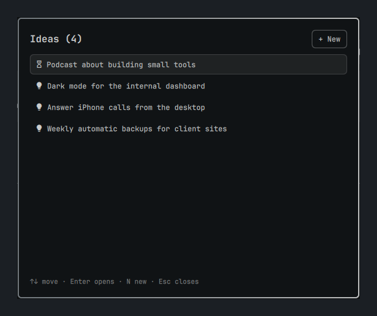

# Ideas for Omarchy

Capture ideas from anywhere in [Omarchy](https://omarchy.org). Type an idea in a quick dialog and it is saved right away. In the background, whichever AI agent CLI you have installed fixes the spelling and gives the idea a short title. Your ideas show up as a list of titles behind a lightbulb icon in the top bar, and clicking a title opens the full idea.



- The interface comes in English, Português, Español and Français
- The AI keeps each idea in the language you wrote it in
- Ideas are stored locally in `~/.local/share/omarchy-ideas/ideas.json`

## Install

```bash
omarchy plugin add https://github.com/weslleycabral/omarchy-ideas.git --enable
```

The lightbulb (󰌵) then shows up in the right section of the bar:

| Action | Result |
|---|---|
| Left-click | Open the list of ideas |
| Right-click | Add a new idea |

### Command and keybindings (optional)

Put the `ideas` command on your PATH:

```bash
ln -s ~/.config/omarchy/plugins/weslleycabral.ideas/bin/ideas ~/.local/bin/ideas
```

To add keybindings, put these lines in `~/.config/hypr/bindings.lua`:

```lua
o.bind("SUPER + I", "New idea", "omarchy-shell shell summon weslleycabral.ideas '{\"mode\":\"new\"}'")
o.bind("SUPER + SHIFT + I", "Ideas", "omarchy-shell shell toggle weslleycabral.ideas '{\"mode\":\"list\"}'")
```

## Usage

| Where | Keys |
|---|---|
| New idea | `Enter` saves · `Shift+Enter` new line · `Esc` closes |
| List | `↑↓`/`jk` move · `Enter` opens · `N` new idea · `Esc` closes |
| Idea | `Copy` · `Delete` (`Del`) · `Esc` back |

```bash
ideas               # open the new-idea box
ideas list          # open the list
ideas open <id>     # open one idea
ideas add "text"    # save an idea from a script
ideas rm <id>       # delete an idea
ideas lang pt       # set the language: en, pt, es, fr (default: $LANG)
ideas json          # print every idea
```

## AI agents

The first agent CLI found on your `PATH` is used, in this order:

1. [Claude Code](https://claude.com/claude-code) (`claude`, Haiku model)
2. [Codex](https://github.com/openai/codex) (`codex`)
3. [Gemini CLI](https://github.com/google-gemini/gemini-cli) (`gemini`)
4. [OpenCode](https://opencode.ai) (`opencode`)

If an agent fails or times out, the next one is tried. If none of them answers, the idea is kept as typed and you get a notification.

Requires `python3`, `notify-send` and `wl-copy`, all of which ship with Omarchy.

## Privacy

Ideas are stored only on your computer. To fix the spelling and write a title, though, the text of each new idea is sent to the AI agent that answers, which means it goes to that agent's provider (Anthropic, OpenAI, Google, or whichever provider OpenCode is set up with), under that provider's terms. Nothing else is sent: no other ideas, no files, no system information.

Do not type passwords or other secrets into an idea. If you want nothing sent anywhere, uninstall the agent CLIs or remove them from the `PATH` of your Omarchy session; ideas are then saved exactly as typed.

## Update

```bash
omarchy plugin update weslleycabral.ideas
```

See [CHANGELOG.md](CHANGELOG.md) for what changed in each version.

## Contributing

Bug reports, translations and pull requests are welcome. [CONTRIBUTING.md](CONTRIBUTING.md) explains how to set up the plugin for development and how to add a language.

## License

[MIT](LICENSE)
